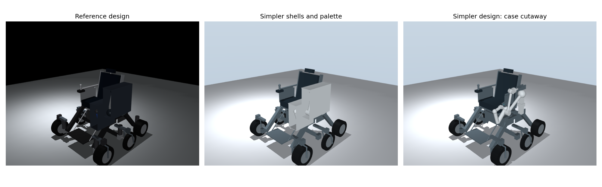

# Autonomous dual-arm assistive wheelchair

A MuJoCo simulation with student-written NumPy kinematics, IK, planning,
trajectories and feedback control. The task detects a bottle, drives to its
table, deploys the arms, grasps and opens the bottle, presents it to a prescribed
recipient, then folds the empty arms into protective cases.



The primary arm has **6 DOF**, the auxiliary arm **3 DOF**. Rear wheels drive
independently; front wheels steer actively and roll passively; middle casters
swivel and roll passively. The simpler presentation uses smooth arm shells,
fewer visible cosmetic details and a restrained colour palette. Collision
geometry and body mass properties are retained by the cosmetic style. The current
mobile design mounts the main arm on a chassis bracket inside the side case,
below and outboard of the armrest; this physical relocation adds a declared
0.40 kg bracket. See [side-case design and validation](docs/SIDE_CASE_MOUNT.md).

The side-case revision passes **107 regression tests**, all **14 expected
comparison outcomes**, and the fresh live delivery-and-fold task.
[Measured validation](docs/SIDE_CASE_MOUNT.md).

## Show the project

Open a VS Code terminal in this folder.

**Inspect the articulated URDF design:**

```sh
.venv/bin/mjpython scripts/view_robot_assets.py --urdf
```

**Run a fresh task in a moving MuJoCo window:**

```sh
.venv/bin/python -B scripts/run_live.py --acknowledge-passenger
```

SPACE pauses/resumes actual physics; 1/2/3/4 request 0.5×/1×/2×/4× speed,
and −/+ decrease/increase speed. Drag rotates the camera and scrolling zooms.
Closing the window cancels the run. The flag supplies an explicit simulated
passenger acknowledgement. Without it, passenger release must be blocked.
Live mode runs one task; comparisons run separately. The viewer runs in its own
process so sensor computations cannot block its Python interpreter. The launcher
handles the native `mjpython` display process on macOS.

For a faster run, add `--speed 2 --fps 60`; use `--fps 30` for less display load.
The updated display caps wall-clock rendering and avoids a catch-up burst after
planning. Physical time may still wait while planning computes; the window labels
those intervals. Requested speed remains limited by available computing power.
Add `--timing-log` to save `display_timing.json` alongside that run's results.

**Replay the saved, validated task in a moving 3D window:**

```sh
.venv/bin/mjpython scripts/replay_autonomous.py
```

Playback uses recorded states. SPACE pauses, R restarts, and 1/2/3 select
half/normal/double speed. Drag to rotate and scroll to zoom. It does not rerun
the controller. [Live and playback details](docs/PLAYBACK.md).

**Notebook:** open [notebooks/wheelchair_current.ipynb](notebooks/wheelchair_current.ipynb),
select `.venv/bin/python`, restart the kernel and choose **Run All**. The default
`WORKFLOW="autonomous"` runs comparisons, graphs, animation and regression checks.
The project folder must stay intact for source/model imports.

## Experiments

```sh
.venv/bin/python -B -m src.run_autonomous --acknowledge-passenger --compare --render
.venv/bin/python -B -m src.run_autonomous --acknowledge-passenger --robustness --output results/full_task_variations
.venv/bin/python -B -m src.robustness
.venv/bin/python -B -m unittest discover -s tests -v
.venv/bin/python scripts/check_notebooks.py
```

The first command writes `results/autonomous_validation/`, including the full
`nominal.gif`, navigation/delivery/storage graphs and `metrics.json`. The second
attempts complete-task pose/noise variations and a moving-obstacle stop. The
third compares reverse caster readiness and payload/material sensitivity.
Expected negative controls are physical task failures; their correct blocking
is recorded separately from successful delivery. Read each saved check rather
than treating every completed program as a successful robot task.

Historical stationary entry points remain `src.run_grasp`, `src.run_transfer`
and `src.run_delivery`; the notebook can select those workflows. Historical
mobility experiments remain `src.run_experiments`. Their documented failures
are retained. [Experiment changes and scope](docs/IMPROVEMENTS.md).

## Design assets and project layout

```text
assets/       generated MJCF, URDF, individual OBJ/STL meshes and folded assembly
models/       single canonical source XML
src/          algorithms, scene builders, controller and physics integration
scripts/      viewing, export, notebook checking and organisation tools
notebooks/    single active notebook
results/      measured experiment data, plots and actual MuJoCo animations
tests/       math, geometry, physics and export regression checks
docs/        context, equations, validation reports and final report
hardware/     future mechanical design review requirements
references/   course requirements and verified historical/development archives
```

[Asset guide](assets/README.md) explains frames, units and which file to open.
Regenerate from the canonical task builder with:

```sh
.venv/bin/python -B scripts/export_robot_assets.py
.venv/bin/python -B scripts/preview_design.py
```

The canonical `models/wheelchair_m1e_rocker.xml` retains its defaults. Autonomous
fixtures explicitly select clearance mounts, 120 N m/rad rocker springs and
40 mm middle tires. These are design hypotheses; exported descriptions are not
independently maintained robot models. STL/OBJ are simulation reference meshes,
not manufacturing drawings. [Hardware handoff](hardware/DESIGN_REVIEW.md).

## Setup

Clone the project and enter its directory:

```sh
git clone https://github.com/uday3036/wheelchair_codex_autonomous.git
cd wheelchair_codex_autonomous
```

Create your own environment; the local `.venv` is not uploaded:

```sh
python3 -m venv .venv
.venv/bin/python -m pip install -r requirements.txt
.venv/bin/python -m ipykernel install --prefix .venv --name wheelchair --display-name "Wheelchair (.venv)"
```

The validated dependency pins are in `requirements.txt` (Python 3.9.6). macOS
rendering uses CGL; Linux offscreen rendering may need EGL/display configuration.
The live display currently uses a POSIX shared-buffer lock and is tested on macOS;
Windows live-viewer compatibility has not been established.

Current poses, CSV logs, metrics, plots and the report PDF are included. Full
rendered videos/GIFs, duplicate runs and large development archives stay local;
they can be regenerated where documented. See [published evidence](results/README.md).

## Report and limits

Read the [course report PDF](docs/COURSE_PROJECT_REPORT.pdf), its
[editable source](docs/COURSE_PROJECT_REPORT.md),
[FINAL_REPORT.md](docs/FINAL_REPORT.md), [IMPROVEMENTS.md](docs/IMPROVEMENTS.md)
and [PROJECT_CONTEXT.md](docs/PROJECT_CONTEXT.md). Detailed earlier engineering
reports remain in `docs/`; [CLEANUP.md](docs/CLEANUP.md) records organisation.

This is a bounded simulated service task. Noisy sensing and additional poses
are tested within stated profiles. General reverse alignment, tight-space/full
swivel guarantees, arbitrary-object perception, SLAM, dropped-object recovery,
liquid handling, real cap/human calibration and hardware readiness remain
unvalidated. The 6 N recipient-force and 10 mm clearance thresholds are explicit
simulation gates, not certified human safety limits. A higher-friction 0.6 kg
stationary pickup does not establish complete mobile delivery at that payload.

# Obstacle navigation demonstration

Run `.venv/bin/python -B scripts/run_live.py --obstacles detour --acknowledge-passenger --speed 2 --output results/obstacle_live`
to detect the bottle, navigate around two orange obstacles, dock and execute the
bottle service. The notebook selects this scenario with
`AUTONOMOUS_OBSTACLES = "detour"`; set it to `None` for the original comparison.
See [planning, limits and validation](docs/OBSTACLE_NAVIGATION.md).
